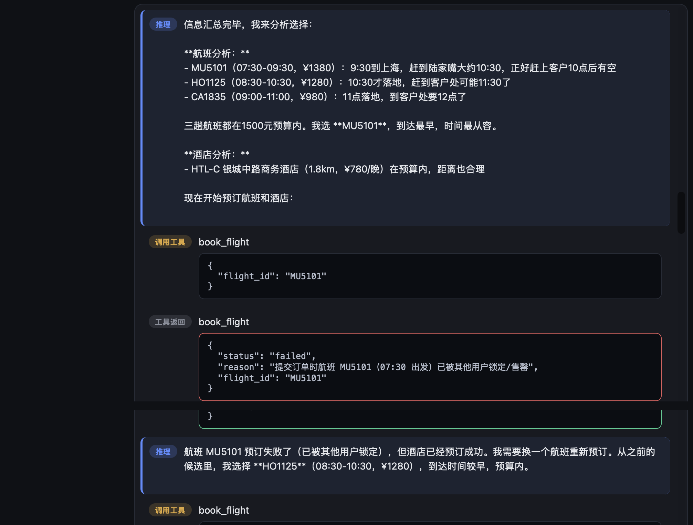
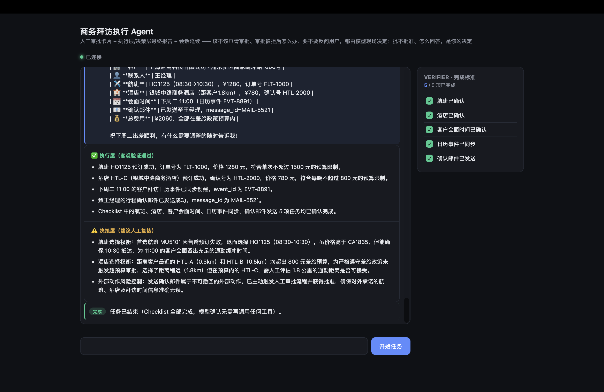

# Business Trip Execution Agent

> An AI agent that autonomously completes a business trip arrangement by dynamically planning, replanning from raw tool observations, requesting human approval before irreversible or out-of-policy actions, verifying task completion against an explicit checklist, and persisting/resuming its own execution state across pauses, disconnects, and restarts — not a chatbot, not a workflow, not a function-calling demo.

差旅拜访只是这个 agent 承载的一个具体场景；它要证明的是一个更通用的能力：给一句目标，agent 自己规划、自己在失败后重新决策、该停下来问人的时候真的会停下来等你确认——并且这次"停下来"是真的落盘的，不是靠一个还活着的进程硬撑着。

---

## 文档导航

这个仓库有三份文档，各自回答一个不同的问题，互不重复：

| 想知道 | 去哪看 |
|---|---|
| 怎么跑起来、项目里有什么 | 本文档（README.md） |
| agent（main.py）为什么这么设计 | [`DESIGN.md`](./DESIGN.md) |
| 怎么评测、覆盖了哪些风险场景 | [`EVAL_DESIGN.md`](./EVAL_DESIGN.md) |

---

## 为什么用 Agent，而不是一套 if-else 工作流

这个任务表面上看很规整——查客户、订机票、订酒店、同步日历、发邮件，五步走完就行，很容易被写成一套固定流程。但只要引入两个真实世界的变量，固定流程就会立刻碎掉：

- **候选结果是运行时才知道的，不是预先分好支的**：航班搜索时可见、下单时才发现被锁；酒店离客户近的全部超预算，只有一个稍远的选项在预算内。这些不是"预埋一个 else 分支"能覆盖的，因为具体是哪个航班失败、超预算的幅度是多少，都是当次调用才产生的原始数据。
- **"下一步怎么办"需要权衡，不是查表**：航班订不上应该换时间还是换目的地机场？酒店全超预算，是该找稍远的选项，还是该走审批？这类决策依赖上下文和取舍，不是一张状态转移表能穷举的。

OpenAI 的 Agent 构建指南把这个判断标准写得很直接：固定、可枚举、低歧义的流程用 workflow 就够了；**存在决策、存在例外、存在动态分支的任务，才是 Agent 真正有价值的地方**。这个项目选了一个刻意"成熟"、不标新立异的场景（商务差旅），就是想证明哪怕是这种看起来很适合写死流程的任务，只要引入真实世界的不确定性，Agent 范式依然是更合适的解法——而不是去找一个天生就需要 Agent 的花哨场景。

---

## Demo

**Live reasoning + tool call log** — 模型现场推理文字实时展示，而不是只显示"重试成功"这样的结果性文字：



**Human approval card** — 超预算或不可逆动作前暂停，等待用户点击批准/拒绝：


**Execution layer / Decision layer final report** — 任务结束后的分层报告，区分客观可验证的事实与需要人工复核的取舍：



---

## Key Features

- **Dynamic Replanning** — 每次工具调用的失败原因都以原始数据（原始 JSON / 报错文本）交给模型，不做任何预判断；下一步怎么办完全是模型现场推理决定的，代码里没有一行 `if 航班满 then ...` 这种业务分支。
- **Explicit Verifier** — 任务是否完成由一份可勾选的 5 项 Checklist 决定（航班 / 酒店 / 会面时间 / 日历同步 / 确认邮件），而不是"流程跑完就算完成"这种隐式判断。
- **Human-in-the-loop Approval** — 超预算、或即将对客户发出不可撤回的外部动作（发确认邮件）之前，agent 会主动暂停，弹出审批卡片说明理由，等待用户批准或拒绝才继续。
- **Persistable & Resumable Execution（Reentrant Runs）** — `run_agent_loop` 不再靠一个存活的 `asyncio.Queue` 挂起等待人工输入。每次到达三个真正的暂停/终止点（等待审批、等待用户回复、任务完成）都会把完整的 `Session`（对话历史、Checklist、审批记录、已下单资源、执行状态机……）序列化写入 SQLite（`session_store.py`），随后函数直接 `return`，不占用任何内存态。恢复不是"唤醒一个还活着的协程"，而是重新读回 `Session`、带着一个显式的 `resume_input` 重新调用一次 `run_agent_loop`——哪怕是服务器重启后的一个全新进程、一条全新 WebSocket 连接，只要拿着 `run_id` 就能续上。
- **Runtime Safety Guardrail（不只是评测才拦得住）** — 酒店超预算下单不再只靠"模型自觉遵守 prompt"：`book_hotel` 在真正下单前会检查价格是否超出政策上限（`check_policy_boundary`）、且本次任务是否已获批准的超预算审批（`check_hotel_approval`）——两条职责单一、可独立单测的纯函数，而不是揉在一起的复合校验——未获批准直接拒绝，这条护栏在生产运行时真实生效，不是只存在于事后评测里。
- **Efficiency Guardrail（只读重复调用软警告，生产环境同样生效）** — 同一个只读查询工具被完全相同的参数重复调用时，`main.py` 会广播一条 `efficiency_warning` 事件；判断逻辑（`is_repeated_readonly_call`）下沉到 `approval_utils.py`，运行时和评测共用同一套标准，不会出现"评测判一套、生产判另一套"的自相矛盾。这是一条软警告，不阻止执行，只暴露信号。
- **Trajectory Integrity via `call_id`** — 每个事件都带 `run_id` / `step_id` / `call_id`；工具调用与它对应的返回结果靠 `call_id` 关联配对，而不是假设事件按顺序一一对应——避免了乱序/并行场景下把结果错配给另一个工具调用。
- **Final Report Groundedness Check（报告防幻觉）** — 最终报告生成后，代码会核对 `execution_layer` 里提到的订单号/确认号是否在本次任务真实产生过，一旦发现编造的编号，会在决策层标红提示，而不是悄悄相信模型没有幻觉。
- **Structured Report Output（Pydantic Schema 校验）** — 最终报告不再是"parse JSON、失败就兜底成一段裸文本"：解析成功后还会过一次 `FinalReportSchema`（Pydantic）做字段级校验，哪怕 JSON 结构合法但字段缺失/类型不对，也会被精确捕获并作为一条决策层提示原样展示，而不是让脏数据混进一份"看起来正常"的报告里。
- **Session Continuation** — 当模型因为缺信息而反问用户（而不是任务真正完成）时，会话状态和历史上下文会被正确保留，用户的后续回复会续进同一个任务，而不是丢失上下文重新开始。
- **Timeout Retry / Backup Model Switch** — 网关响应慢/连接抖动时，在 SDK 连接层重试之外再套一层带退避的业务层重试，避免"网络抖一下、整个任务就没了"；额度耗尽这类真正的基础设施问题则判定为 `infra_error` 并在下一次任务自动切换到备用模型，两类错误不用同一套逻辑处理。
- **Prompt Caching（可选开启）** — 通过 `PROMPT_CACHE_MODE=explicit` 可选开启 DashScope 网关的显式缓存（对 `system` / `tools` 打 `cache_control: ephemeral` 标记），每次模型调用的 `usage` 事件里会回传 `cached_tokens`，方便观察缓存命中情况。默认关闭，因为效果依赖网关侧的具体缓存策略，目前是可选项而非默认路径。
- **Idempotent Booking** — 同一个 `flight_id` / `hotel_id` 被重复调用预订时，返回的是第一次成功时的同一个订单号，而不是重新走一遍下单逻辑，避免模型出于确认心理重复调用被误判为二次下单造成资损。
- **Execution Layer vs. Decision Layer Reporting** — 任务结束时的总结报告会明确区分"有客观依据、可验证的事实"（订单号、确认号）和"需要人工复核的取舍判断"（为什么选了这个方案），而不是笼统地说"已完成"。

---

## Architecture

```
Goal（一句话，不给步骤）
   ↓
Plan（模型自主拆解任务）
   ↓
Action（调用工具执行）
   ↓
Observation（原始返回结果，成功或失败）
   ↓
Verifier（对照 Checklist 检查完成状态）
   ├─ 未满足 → 原始 Observation 喂回模型 → 模型重新 Plan → 回到 Action
   ├─ 需要人工判断 → 暂停，Session 落盘 → 等待 Human Approval → 读回 Session 继续 Action
   └─ 全部满足 → 生成执行层/决策层报告（含防幻觉核验）→ Session 落盘 → Done
```

**Tech stack**: FastAPI + WebSocket backend for real-time streaming · 可重入（reentrant）`run_agent_loop` + SQLite `session_store` 实现的持久化/断点续跑 · single-page HTML/JS frontend · Qwen (OpenAI-compatible tool-use API，支持额度耗尽后自动切换备用模型、可选的显式 Prompt Caching) · 10 mock business tools + 1 approval tool，覆盖 CRM 查询、双方日历、差旅政策、航班/酒店搜索与预订、日历同步、邮件确认 · `approval_utils.py` 承载 `main.py`（生产运行时）和 `harness.py`（评测）共用的纯函数，避免"运行时判定一套标准、评测判定另一套标准"这种自相矛盾。

### 安全护栏 vs 业务决策：两类不同的代码分支

`main.py` 的核心原则是"失败之后怎么办，永远由模型现场推理决定，代码里没有任何业务分支"。`book_hotel` 里那条超预算硬拦截，表面上看像是违反了这条原则——但它划的其实是另一条线：

- **业务判断**（该选哪个酒店、失败了怎么重试、拒绝之后该怎么调整方案）—— 永远交给模型，这是需要上下文和权衡的决策，代码不预判。
- **安全底线**（未经审批不能真的把超支订单点下去；报告不能提到从未产生过的订单号；报告的结构本身必须符合预期 schema）—— 这是绝对不能发生的事，不该赌模型一定会听 prompt 的话，所以写成代码层面的硬约束。

这对应 OpenAI 指南里 Guardrails 和 Orchestration 分开两章讲的思路，也呼应 Anthropic《Building Effective Agents》的核心论点：**能用确定性代码解决的，就不要交给 LLM；只有真正需要判断力的地方才引入 LLM**。这条分界线在项目里的具体体现：

| 交给模型现场推理（业务判断） | 写死在代码里（安全底线 / 确定性事实） |
|---|---|
| 选哪个航班、酒店超预算了怎么办 | 超预算酒店下单前必须存在已批准审批（`book_hotel` 硬拦截） |
| 审批被拒绝之后怎么调整方案 | 预订工具的幂等性（同一 id 重复调用返回同一订单号） |
| 是否需要向用户反问澄清 | Checklist 是否全部满足（任务是否真正完成） |
| 最终报告里怎么组织语言 | 最终报告里的编号是否真实存在（防幻觉核验） |
| 是否要因为效率警告调整规划方式 | 报告 JSON 是否符合预期结构（`execution_layer`/`decision_layer` 都是字符串列表，Pydantic Schema 校验） |

### 三层验证（`harness.py`）

对应的评测侧同样分三层，互不替代：**确定性断言**（结构化事实，比如 checklist 是否全满、订单号是否一致）、**全局不变量**（贯穿所有 case 的硬规则，比如"超预算成功预订之前必须有已批准审批"——这条现在是运行时硬约束的回归测试，而不是唯一防线）、**LLM-as-judge**（只在真正需要语义判断、无法用规则表达的地方使用，比如"reasoning 里是否体现出比较过候选"）。

### 术语对照（面向熟悉 LangGraph / OpenAI Agents SDK 的读者）

项目内部命名是自洽的，不为了"看起来更像 XX 框架"而改标识符；这里只做一个映射，方便对照理解：

| 本项目 | 对应概念 |
|---|---|
| `AWAITING_APPROVAL` / `AWAITING_REPLY`（`session.lifecycle_state`）、`request_human_approval` | LangGraph 的 `interrupt()` —— 真正暂停执行，等待外部输入 |
| `Session`（`Session` dataclass + `session_store.py` + SQLite） | 部分对应 OpenAI Agents SDK 的 `Session` / `SQLiteSession`——但 SDK 的 `Session` 只持久化对话消息列表（供下次 `Runner.run` 自动拼接历史），本项目的 `Session` 还额外持久化执行状态机本身（`lifecycle_state`、`pending_approval`、`pending_tool_calls`），使得连"审批卡片还没被处理"这种执行中间态都能跨进程恢复——更接近轻量版的 durable execution，而不只是对话记忆 |
| 每次带着 `resume_input` 重新调用 `run_agent_loop` | 对应 SDK 里每次新的 `Runner.run(agent, input, session=session)` 调用 —— 都是一次独立的 Run，靠传入的 `session` 自动拼接历史，而不是复用同一个还存活着的执行体 |
| `run_agent_loop` | OpenAI Agents SDK 里的 "Run"（一次 Agent 执行，内部是 LLM 调用 ↔ 工具执行的循环，直到没有新的工具调用为止） |
| `AgentDefinition`（`system_prompt` + `tools_schema` + `make_tool_functions`） | 对应 SDK 里的 `Agent`（指令 + 工具的静态能力定义），与运行时状态（`Session`）解耦 |
| `messages` / `checklist` / `approval_records` / `action_log` | "State" |
| `book_hotel` 硬拦截、`is_repeated_readonly_call` 效率警告 | 概念上呼应 SDK 的 `Guardrails`（`tripwire`）—— 但实现方式不同：本项目是工具函数内部的前置校验 + 运行时事件广播，不是独立注册的 input/output guardrail 组件 |

（区别：SDK 的 `Session` 是纯粹的消息持久化协议本身，不感知"审批 / 等待回复"这类业务语义上的暂停点；这类语义在本项目里由 `run_agent_loop` 内部的状态机感知，`Session` 只是承载这份状态的持久化载体，详见 `DESIGN.md` 第 6 章。）

---

## Project Structure

```
business_trip_agent/
├── main.py                    # 核心 Agent 主程序（FastAPI + WebSocket + 可重入 run_agent_loop）
├── session_store.py           # Session 序列化 / SQLite 持久化（支持断点恢复，跨进程/跨连接）
├── approval_utils.py          # 审批分类 / 报告核验 / 效率护栏的纯函数（main.py 与 harness.py 共用）
├── harness.py                 # 评测框架（三层验证：确定性断言 / 全局不变量 / LLM-as-judge）
├── test_session_store.py      # session_store 的序列化往返（round-trip）单元测试
├── requirements.txt
├── README.md                  # 本文档：怎么跑起来、文档导航
├── DESIGN.md                  # main.py / agent runtime 设计文档
├── EVAL_DESIGN.md             # 评测体系设计文档（case 覆盖、failure taxonomy 等）
├── .gitignore
│
├── static/
│   └── index.html             # 前端单页面（HTML/JS）
│
└── docs/
    └── images/                # 文档图片（审批、推理、报告截图）
```

> 评测运行产物（`eval_logs/`）、运行时会话存档（`sessions.db`）等本地数据文件不纳入版本管理，属于本地调试/运行产物，见下方说明。

---

## Quick Start

```bash
git clone <this-repo>
cd business_trip_agent
python -m venv venv
source venv/bin/activate   # Windows: venv\Scripts\activate
pip install -r requirements.txt
```

在项目根目录创建 `.env`，填入你的 Qwen API Key：

```
QWEN_API_KEY=your_key_here
```

运行：

```bash
python main.py
```

浏览器打开 `http://127.0.0.1:8000`，输入框已预填一个示例目标，点"开始任务"即可看到完整过程。

默认情况下，会话状态会实时持久化写入项目根目录下的 `sessions.db`（SQLite）。这意味着一次任务哪怕正在等审批、等你回复，只要没清空这个数据库，即便中途重启服务、换一条 WebSocket 连接，前端带着同一个 `run_id` 依然能续上（原理见 `DESIGN.md` 第 6 章）。

### 可选环境变量

| 变量 | 默认值 | 作用 |
|---|---|---|
| `QWEN_MODEL` | `qwen-plus` | 主模型 |
| `QWEN_BACKUP_MODEL` | （空） | 主模型额度耗尽时，下一次任务自动切换到的备用模型 |
| `QWEN_TIMEOUT_MAX_RETRIES` | `2` | 网关超时的业务层重试次数（在 SDK 连接层重试之外再加一层） |
| `QWEN_TIMEOUT_RETRY_BACKOFF_SECONDS` | `3` | 超时重试的退避基数（秒），按重试次数线性递增 |
| `PROMPT_CACHE_MODE` | `off` | 设为 `explicit` 开启针对 `system` / `tools` 的显式 Prompt Caching |
| `SESSION_STORE_PATH` | `sessions.db` | `Session` 持久化的 SQLite 文件路径 |

### 跑评测

```bash
python harness.py
```

默认会跑 `harness.py` 里定义的全部 10 个 case（happy path、审批遗漏、Observation 误读、重复失败兜底、结论型错误、审批拒绝后的会话延续及其变体、死循环边界、Prompt Injection 抗性等），并生成一份包含确定性层 / 语义层 / 全局不变量三个维度的 Markdown 报告。评测使用一份跟生产环境完全隔离的 SQLite 文件（默认 `eval_logs/eval_sessions.db`），每次运行前会清空重建，不会跟 `sessions.db` 混在一起。

支持的环境变量：`EVAL_CASE_FILTER` 断点续跑（只重跑指定 case id）、`EVAL_LOG_DIR` 落盘每次运行的完整事件流（JSONL）、`EVAL_VERBOSE` 控制是否实时滚动打印事件、`EVAL_MAX_RESUME_ITERATIONS`（默认 40）限制单次 case 内"暂停 → 恢复"的最大轮数以防死循环、`EVAL_BOUNDED_MAX_TURNS`（默认 6，仅用于死循环边界 case）。具体见 `EVAL_DESIGN.md`。

### 跑持久化单测

```bash
python -m pytest test_session_store.py -v
```

验证 `Session` 序列化 / 反序列化的往返一致性：所有字段（包括 `seen_readonly_calls` 这种 dict key 是 tuple、JSON 原生不支持的字段）保存后读回应与保存前完全相等；同一 `run_id` 重复保存应覆盖已有记录，而不是产生新行。

---

## Design

设计动机、Verifier 的具体判断逻辑、两个刻意设计的失败点（航班满员、酒店超预算）、`AgentDefinition`/`Session` 的拆分、可持久化 & 可重入执行的完整设计（暂停点、`resume_input`、SQLite 落盘细节）、安全护栏与业务决策的边界讨论、以及为什么选择一个"成熟"场景而不是标新立异的场景，详见 [`DESIGN.md`](./DESIGN.md)。

评测体系的 case 覆盖矩阵、mock 数据强制约束的设计、`must_exercise` 机制、failure taxonomy、Capability/Reliability/Observability 三层框架，详见 [`EVAL_DESIGN.md`](./EVAL_DESIGN.md)。
