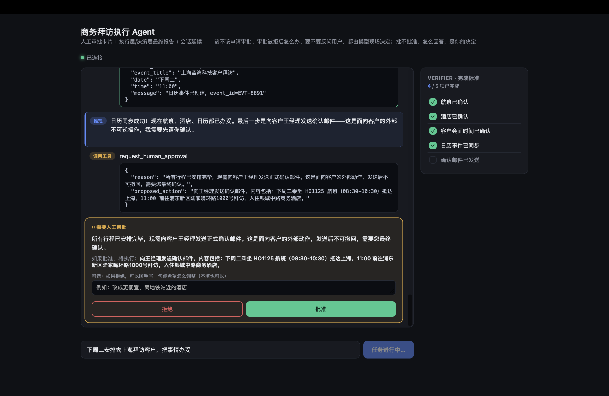

# 商务拜访执行 Agent

**从一句拜访目标出发，规划行程、处理审批，并核对执行结果。**

这个项目围绕“下周二去上海拜访客户，把事情办妥”这一任务，探索 Agent 如何在航班售罄、酒店超预算或审批被拒绝后继续调整方案，同时把重要决定留给用户。

我负责任务与完成标准设计、人工审批与恢复机制、执行约束和评测，在 AI Coding 辅助下实现了可运行的交互原型。已有成果包括行程规划、审批界面、任务暂停与续接、执行记录和分层结果报告。

## 我的贡献

| 关键问题 | 我的设计与实现 |
| --- | --- |
| 怎样判断任务真正完成 | 将拜访目标拆为 Checklist，核对订单、审批记录与报告中的事实，而不只看模型最后的回答 |
| 等待审批后怎样继续，怎样避免重复执行 | 保存任务状态与待执行动作；用户回复后继续处理，对重复预订做幂等约束 |
| 怎样让模型与多个协作者遵守同一套规则 | 将差旅政策、角色权限和具体动作审批落到执行层，协作者的建议不能放宽预算与审批要求 |
| 怎样发现顺利 Demo 没有暴露的问题 | 构建 12 个场景用例，检查风险路径是否真正触发，并通过执行记录回放分析失败原因 |

## 已有证据

| 入口 | 内容 |
| --- | --- |
| [界面与交互](#界面与交互) | 已有审批、执行过程与结果报告截图 |
| [贡献与验证记录](docs/VERIFICATION.md) | 上述机制对应的实现、测试与验证范围 |
| [Eval 设计与失败案例分析](eval/EVAL_DESIGN.md) | 场景构造、完成标准与失败归因方法 |

## 界面与交互

用户可以批准或拒绝具体动作，任务随后继续处理。以下为已有原型截图，预订与发信采用 mock/sandbox。

[执行过程](docs/images/reasoning.png) · [执行事实与决策建议分层报告](docs/images/report.png)

## 成果与验证范围

- **离线验证：** 2026-10-14 复核记录为 **35 项测试通过**，覆盖状态保存、审批约束、协作规则、上下文与记忆等机制。
- **实现范围：** 业务执行循环与治理机制由项目实现；模型调用接入 Qwen。多 Agent 协作借鉴 agents-as-tools 模式，未使用 OpenAI Agents SDK 编排。
- **业务边界：** 邮件、日历写入及机酒预订仍在 mock/sandbox 中验证。个人日历已有只读接入路径，本轮没有真实账号验收记录；完整模型 Eval 未复验。12 个场景是评测设计，不代表全部 live 运行通过。
- **待补材料：** 带版本与任务记录的完整短 Demo、脱敏 Eval 结果、真实只读日历验收。现有截图未绑定公开 run ID。

## 项目资料

[产品与系统设计](DESIGN.md) · [协作与审批设计](docs/MULTI_AGENT_DESIGN.md) · [实现与开发指南](docs/IMPLEMENTATION.md) · [工具契约](skills_registry.md)

相关作品：[Forge Agent：自主实现 Coding Agent](https://github.com/mclin082-alt/forge-agent) · [Codex 源码研究](https://github.com/mclin082-alt/coding-agent-runtime) · [Enterprise AI Workspace：SDK 集成](https://github.com/mclin082-alt/enterprise-ai-workspace)。
